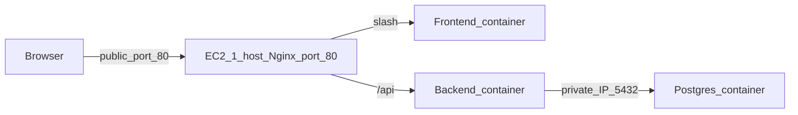

# ShopLite

ShopLite is a small product catalogue with three tiers. A React page lists products and adds new ones. An Express API reads and writes those rows. PostgreSQL stores them.

Users reach the app only through EC2-1 on port 80. The database has no public IP.

## Architecture



| Tier | Where it runs | Image |
|---|---|---|
| Frontend | EC2-1, public subnet | `<dockerhub-user>/shoplite-frontend:1.0.0` |
| Backend | EC2-2, private subnet, no public IP | `<dockerhub-user>/shoplite-backend:1.0.0` |
| Database | EC2-3, private subnet, no public IP | `postgres:16` |

EC2-1 also runs Nginx on the host, installed with apt. That Nginx is the only public door. It sends `/` to the frontend container on `127.0.0.1:8080` and `/api` to EC2-2's private IP on port 3000. The Nginx inside the frontend image only serves the built React files.

EC2-2 and EC2-3 sit in a private subnet. Their route to the internet is a NAT gateway in the public subnet, so they can pull images and install patches. Nothing on the internet can open a connection to them.

Each instance runs its containers on a user-defined bridge network named `shoplite`. That network does not cross instances, so the backend uses EC2-3's private IP, not the Docker name `db`. Postgres data lives in the named volume `pgdata`.

## Docker Hub images

Tag `1.0.0` is the tag to deploy. Build from the app directories, tag with your Docker Hub username, and push to public repositories.

```bash
docker login

docker build -t <dockerhub-user>/shoplite-backend:1.0.0 backend
docker push <dockerhub-user>/shoplite-backend:1.0.0

docker build -t <dockerhub-user>/shoplite-frontend:1.0.0 frontend
docker push <dockerhub-user>/shoplite-frontend:1.0.0
```

Confirm both repositories are public and that the tag `1.0.0` is listed. Database settings are passed with `docker run -e`. They are not copied into the image.

Local proof, against Postgres published on port 5433:

```bash
docker run --rm -p 3001:3000 \
  -e DB_HOST=host.docker.internal \
  -e DB_PORT=5433 \
  -e DB_USER=shoplite \
  -e DB_PASSWORD=shoplite \
  -e DB_NAME=shoplite \
  shoplite-backend:1.0.0
```

`GET /api/products` on port 3001 returns the rows. The same image with no database variables exits. The frontend image on port 8080 returns the ShopLite page.

## Run locally

Postgres is the `shoplite-db` container. Start it, then start the API and the Vite app in two terminals.

```bash
docker start shoplite-db
```

```bash
cd backend && npm start
```

```bash
cd frontend && npm run dev
```

Open http://127.0.0.1:5173. Copy `backend/.env.example` to `backend/.env` and set `DB_PASSWORD` before the first backend start. The local database is published on port 5433.

## Deployment

Region used for this design: `us-west-2`. One availability zone. Ubuntu 24.04. Instance type `t3.micro`. No source is copied to the instances, and nothing is built there. Application containers are pulled from Docker Hub.

A NAT gateway bills while it exists. Terminate the instances and delete the NAT gateway and its Elastic IP after grading.

### Network

1. Create a VPC `10.0.0.0/16`.
2. Public subnet `10.0.1.0/24`. Private subnet `10.0.2.0/24`. Turn off auto-assign public IP on the private subnet.
3. Attach an internet gateway. Public route table: `10.0.0.0/16` local, `0.0.0.0/0` to the internet gateway. Associate it with the public subnet.
4. Create a NAT gateway in the public subnet with its own Elastic IP.
5. Private route table: `10.0.0.0/16` local, `0.0.0.0/0` to the NAT gateway. Associate it with the private subnet. Do not add the internet gateway here.

### Security groups

| Group | Inbound | Outbound |
|---|---|---|
| EC2-1 web | TCP 80 from `0.0.0.0/0`. TCP 22 from your IP `/32` | TCP 80 and 443 to `0.0.0.0/0`. TCP 3000 to the EC2-2 group |
| EC2-2 API | TCP 3000 from the EC2-1 group. TCP 22 from the EC2-1 group | TCP 5432 to the EC2-3 group. TCP 80 and 443 to `0.0.0.0/0` |
| EC2-3 database | TCP 5432 from the EC2-2 group. TCP 22 from the EC2-1 group | TCP 80 and 443 to `0.0.0.0/0` |

Port 5432 is never opened to `0.0.0.0/0`.

### Instances

- EC2-1 in the public subnet, public IP, web security group.
- EC2-2 in the private subnet, no public IP, API security group.
- EC2-3 in the private subnet, no public IP, database security group.

Reach the private instances from your laptop through EC2-1:

```bash
ssh -i shoplite.pem -J ubuntu@EC2_1_PUBLIC_IP ubuntu@EC2_2_PRIVATE_IP
```

### Containers

On each instance, install Docker Engine and create the network:

```bash
docker network create shoplite
```

On EC2-3:

```bash
docker volume create pgdata
docker run -d --name db --restart unless-stopped \
  --network shoplite \
  -p 5432:5432 \
  -v pgdata:/var/lib/postgresql/data \
  -e POSTGRES_USER=shoplite \
  -e POSTGRES_PASSWORD='choose-a-long-password' \
  -e POSTGRES_DB=shoplite \
  postgres:16
```

On EC2-2, pull the version tag and point `DB_HOST` at EC2-3's private IP:

```bash
docker pull <dockerhub-user>/shoplite-backend:1.0.0
docker run -d --name backend --restart unless-stopped \
  --network shoplite \
  -p 3000:3000 \
  -e DB_HOST=EC2_3_PRIVATE_IP \
  -e DB_PORT=5432 \
  -e DB_USER=shoplite \
  -e DB_PASSWORD='choose-a-long-password' \
  -e DB_NAME=shoplite \
  <dockerhub-user>/shoplite-backend:1.0.0
```

On EC2-1, bind the frontend to loopback so users cannot skip Nginx:

```bash
docker pull <dockerhub-user>/shoplite-frontend:1.0.0
docker run -d --name frontend --restart unless-stopped \
  --network shoplite \
  -p 127.0.0.1:8080:80 \
  <dockerhub-user>/shoplite-frontend:1.0.0
```

Install Nginx with apt. In [nginx/shoplite.conf](nginx/shoplite.conf), replace `10.0.2.20` with EC2-2's private IP, copy the file to `/etc/nginx/sites-available/shoplite`, enable the site, and reload Nginx. `proxy_pass` has no path after the port, so `/api/products` is forwarded unchanged.

Add a product in the browser at `http://EC2_1_PUBLIC_IP`. Remove the database container, start a new one on the same `pgdata` volume, and refresh. The product is still there. Reboot EC2-3 and the container comes back because of `--restart unless-stopped`.

## Part E

**Q1. The page loads, and every API call is 502.**

The HTML arrived, so host Nginx and the frontend container on EC2-1 are up. A 502 means Nginx opened `/api` and did not get a valid response from the upstream. I would read `/var/log/nginx/error.log` on EC2-1 first. The usual lines are "connection refused" or a timeout to EC2-2's private IP on port 3000. Next I would check that the EC2-2 security group allows port 3000 from the EC2-1 security group, then `docker ps` and `docker logs backend` on EC2-2. If that container is restarting, the next hop is Postgres: `DB_HOST` must be EC2-3's private IP, and the EC2-3 security group must allow 5432 from the EC2-2 group. I fix the first hop that fails and then retry the page.

**Q2. An OS patch has to reach EC2-3 without putting the database on the internet.**

EC2-3 has no public IP. Its subnet routes `0.0.0.0/0` to the NAT gateway, not to the internet gateway. I SSH through EC2-1 with `ProxyJump`, then run `sudo apt update` and `sudo apt upgrade`. Those connections leave through the NAT gateway. Nobody on the internet can open port 5432, because there is still no public IP and the security group does not allow the world. I would not add a public IP for the duration of the patch.

**Q3. A bad backend image is live and the old one must be back within two minutes.**

The previous image is still on Docker Hub as `1.0.0` after a newer tag is pushed. On EC2-2 I pull `<dockerhub-user>/shoplite-backend:1.0.0`, remove the running backend container, and start it again with the same network, port, restart policy, and database variables, using tag `1.0.0`. The database volume is left alone. The tag is what makes this fast. A tag of only `latest` would already point at the broken build, so there would be no old image to pull.

**Q4. Someone opened the database port to `0.0.0.0/0`.**

Anyone who can route to that port can attempt to log in to Postgres. This design has two layers in the way. EC2-3 has no public IP and its subnet has no route to the internet gateway, so the internet still has no path to the instance. The security group should also allow 5432 only from the EC2-2 group. If I found the open rule I would delete it, then try the port from outside the VPC and confirm it does not connect.

**Q5. Traffic grows ten times.**

The database tier fails first. Every list and every new product is a query to one Postgres on one small instance, and the data directory is a single volume on that instance. The frontend is static files, so it stays cheap. The backend is one Node process and would be the next limit. I would move Postgres to a larger instance in the same private subnet, still with no public IP, and add a second backend instance. Host Nginx on EC2-1 would forward `/api` to both backends. The database port would stay open only to the backend security group.

## Screenshots to add after the instances are up

- The app in a browser, address bar on EC2-1 port 80, with a product listed.
- `docker ps` on EC2-1, EC2-2, and EC2-3.
- `docker network ls` and `docker network inspect shoplite` on each EC2.
- `docker volume ls` and `docker volume inspect pgdata` on EC2-3.
- Inbound rules of each security group.
- EC2-3 instance details showing no public IP.
- The same product still listed after the database container is removed and started again on `pgdata`.

## After grading

Terminate EC2-1, EC2-2, and EC2-3. Delete the NAT gateway and release its Elastic IP. Delete the security groups, subnets, route tables, internet gateway, and VPC after the instances are gone.
